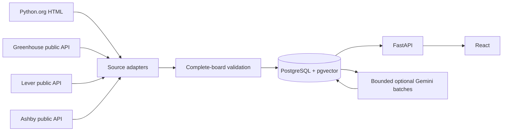

# JobPulse

JobPulse indexes public job postings in PostgreSQL/pgvector and serves them through FastAPI and React. Existing Gemini enrichment, semantic search, resume matching, and recommendations remain available. Public-board ingestion runs sequentially through a CLI or Airflow; no message broker is required.

## Sources and configuration

| Source | Configuration | Public endpoint / behavior |
| --- | --- | --- |
| Python.org | `JOBPULSE_SOURCES=python.org` | Existing HTML listing and detail parser; canonical source links and listing IDs |
| Greenhouse | `JOBPULSE_GREENHOUSE_BOARDS` | `https://boards-api.greenhouse.io/v1/boards/{board}/jobs?content=true` |
| Lever | `JOBPULSE_LEVER_BOARDS` | `https://api.lever.co/v0/postings/{board}?mode=json&skip=0&limit=100`; `region=eu` selects `api.eu.lever.co` |
| Ashby | `JOBPULSE_ASHBY_BOARDS` | `https://api.ashbyhq.com/posting-api/job-board/{board}?includeCompensation=true`; only `isListed=true` |

Each API configuration is a JSON array, for example:

```dotenv
JOBPULSE_SOURCES=python.org,greenhouse,lever,ashby
JOBPULSE_GREENHOUSE_BOARDS=[{"board":"your-public-board-token","company":"Actual employer name"}]
JOBPULSE_LEVER_BOARDS=[{"board":"your-public-company-id","company":"Actual employer name","region":"global"}]
JOBPULSE_ASHBY_BOARDS=[{"board":"your-public-board-name","company":"Actual employer name"}]
```

Replace placeholders with permitted public employer boards. Enabling an API source with no boards is a configuration error. `company` is optional operator-supplied attribution because these APIs do not consistently supply the employer name; a board slug is never substituted for a missing company. Missing dates, locations, salary, and employment information stay null. Greenhouse `updated_at` is not treated as a posting date. Lever descriptions include additional sections and lists. Ashby compensation is preserved as source JSON text, with currency extracted only when unambiguous; `isRemote=false` does not imply on-site work.

Official references: [Greenhouse Job Board API](https://developers.greenhouse.io/job-board.html), [Lever Postings API](https://github.com/lever/postings-api), [Ashby Public Job Posting API](https://developers.ashbyhq.com/docs/public-job-posting-api). These are public posting endpoints, not authenticated ATS management APIs. API availability is not a redistribution license: review each employer's and provider's applicable terms before indexing or republishing descriptions. Source links and attribution are retained. No access-control, CAPTCHA, or rate-limit bypass is implemented.

## Architecture



The adapter contract is `fetch(Board) -> list[Job]`. Fetch all pages and validate identities/URLs before entering a write transaction. `jobpulse.ingestion.pipeline` isolates board failures and records a status for each run. API calls originate on the server, never in React.

Identity is `(source, source_board, source_job_id)`, falling back to the source canonical URL when no stable ID exists. Changing a URL with the same ID updates the existing database row and preserves all job foreign keys. Known non-null job fields survive missing incoming values. A deterministic SHA-256 hash of normalized content detects meaningful changes. First-seen time is preserved; last-seen time advances on observation. Unchanged jobs do not trigger AI generation.

A board advisory lock serializes writes. A run older than an already completed run cannot overwrite it. Transactions are atomic per board, with 30-second lock and 120-second statement limits, at most 10,000 listings per board, and 250-row write batches. Lever pagination is limited to 100 pages; repeated IDs, malformed pages, or limit exhaustion fail the complete run. A successful empty API board is a complete snapshot; an empty/malformed Python.org page fails closed.

Jobs absent from a **successful complete snapshot of their own board** become inactive only after seven days without observation. Failed or incomplete runs cannot sweep freshness. `--backfill` disables deactivation entirely. Cross-provider exact company/title/location matches create `job_duplicate_candidates`; they are review candidates, never automatic merges. This is deliberately conservative and may miss duplicates with different wording.

Semantic changes (title, company, location, description, employment, workplace or compensation) mark enrichment `stale` and embeddings `is_stale=true`. Stored artifacts are retained, excluded from matching/search while stale, and eligible for the bounded AI batches. Revision checks discard AI results generated from a job that changed in the meantime. The AI batch fixes from PR #1 retain NULL-safe eligibility and skip embeddings already current for the configured model.

## Local development

Requires Python 3.12, Node 24, and Docker Compose v2. Start from the existing checkout; there is no need for another worktree.

```bash
cp .env.example .env
# Edit .env: set a local DB password and your permitted public boards.
python -m venv .venv
. .venv/bin/activate
pip install --require-hashes -r requirements-dev.lock
npm --prefix frontend ci

docker compose up -d db
docker compose run --rm migrate
python -m jobpulse.database.migrate check
python -m jobpulse.ingestion.pipeline --backfill
python -m uvicorn api:app --reload --port 8000
# In a separate terminal:
npm --prefix frontend run dev
```

Configuration is loaded from `.env`; shell environment variables take precedence. The Vite proxy forwards `/api` requests to the API on port 8000. Browse the Vite address printed in your own terminal. Before ingestion, the API returns an empty page rather than a fabricated listing.

The original `python main.py` entrypoint still runs a Python.org pass and exports `data/jobs.json`. The multi-source CLI is preferred:

```bash
python -m jobpulse.ingestion.pipeline                     # all enabled boards
python -m jobpulse.ingestion.pipeline --source lever       # configured Lever boards
python -m jobpulse.ingestion.pipeline --backfill           # repeat safely, no stale sweep
```

CLI output contains per-board status and fetched/inserted/updated/unchanged/failed/stale counts; exit status is nonzero if a board fails. A failed board does not prevent subsequent boards from running. Error logs include source, board, run ID and exception type, not response bodies or secrets. An interrupted process can leave a `running` run; it is not treated as a successful refresh. Re-run the board to recover. Database migration/connection failure is an environment failure and exits nonzero.

## HTTP reliability

Requests use explicit 10-second connect / 30-second read timeouts, up to three retries for connection failures, timeouts, HTTP 429 and 5xx, and exponential backoff. `Retry-After` seconds or HTTP dates are respected; a delay over 120 seconds stops the board for a later retry rather than retrying early. Requests are sequential and paced (`JOBPULSE_HTTP_PACE_SECONDS=0.25`). Redirects and unsupported source hosts are rejected. Response size is capped at 20 MB. Invalid JSON or required listing fields fail the board without partial persistence. Optional Python.org detail failures retain existing known fields; the complete listing inventory controls freshness.

Live validation of the operator-selected Stripe, Palantir (US/global), Ramp, and Python.org boards uses a dedicated randomly named database, imports at most 20 jobs per source, repeats imports, tests an update, and removes that database. It never calls Gemini or sweeps freshness. The administrative connection must permit CREATE DATABASE:

```bash
python scripts/validate_public_sources.py --limit 20 --output /tmp/jobpulse-live-validation.json
```

The validator fetches the public snapshot before selecting its sample; `fetched` is the source snapshot count, `sampled` is at most 20, and `skipped` counts unsampled records. Only the disposable sample is written. `updated` counts its synthetic change check, not a claim that the provider changed. Failed network access produces a failed per-source result and a nonzero exit status. Public endpoints/terms must be verified before using the data in production.

## API and frontend

`GET /jobs` returns `{items,total,page,page_size,ingestion}`. This replaces the old unbounded array response; clients should read `items`. Empty results return HTTP 200 with `items: []`. Supported filters: `source`, `keyword` (title/description), `company`, `location`, `employment_type`, `workplace_type` (`remote`, `hybrid`, `on-site`), `page` (1..10000), `page_size` (1..100). Results sort by supplied posting date, then ID; missing posting dates sort last. Detail is `GET /jobs/{id}`. Records expose both legacy `url` and canonical `job_url`, an optional `apply_url`, attribution, content hash, first/last seen and active status.

React uses server pagination/filtering, shows source attribution, available compensation and descriptions, actual recorded timestamps, and external application links. Missing fields, loading, empty results and errors have explicit states. Latest per-board ingestion failures remain visible. Ingestion metadata describes the latest run, not a promise of real-time source freshness.

Existing endpoints remain: `/jobs/semantic-search?q=...&top_k=10`, `/resumes/{resume_id}/match/{job_id}`, `/health/live`, `/health/ready`. Existing `scripts/smoke_*.py`, `scripts/batch_enrichment.py`, and `scripts/batch_embeddings.py` remain available. Gemini requires `GEMINI_API_KEY` and provider egress; no live Gemini calls occur in automated tests. See the scripts' `--help` before enabling paid workflows.

## Database migrations and operations

[Migration instructions](docs/runtime.md) cover the inherited migration runner. `001`–`003` are retained byte-for-byte from PR #2. New `004_multisource.sql` adds board identity, nullable source fields, hashes, revision/status tracking, candidate duplicates and stale embeddings. `005_duplicate_lookup.sql` adds the normalized cross-provider lookup index; `006_source_metadata.sql` retains provider categories and supplemental public fields as JSONB. Neither migration deletes existing jobs or AI records. Migration history is checksum-validated under a database advisory lock. Duplicate legacy source identities fail transactionally and require operator review; do not delete data or edit applied migrations to force an upgrade. Back up a production database before applying changes. API startup only checks schema readiness.

Validate imported counts and failures:

```bash
docker compose exec db psql -U jobpulse -d jobpulse -c \
  'SELECT source,source_board,count(*) AS jobs,count(*) FILTER (WHERE is_active) AS active FROM jobs GROUP BY 1,2;'
docker compose exec db psql -U jobpulse -d jobpulse -c \
  'SELECT source,source_board,status,fetched,inserted,updated,unchanged,failed,stale,finished_at FROM ingestion_runs ORDER BY started_at DESC LIMIT 20;'
```

Candidate duplicates are in `job_duplicate_candidates`, initially `review_status='pending'`. Review them manually; ingestion never changes job identity based on a candidate.

## Docker demo / deployment

```bash
cp .env.example .env
# Set DB_PASSWORD; configure real public employer boards as above.
docker compose up -d --build
# Migrations run before the API; frontend waits for API readiness.
docker compose run --rm ingest python -m jobpulse.ingestion.pipeline --backfill
curl --fail 'http://127.0.0.1:3000/api/jobs?page_size=5'
```

The frontend is served by Nginx, proxying `/api` to FastAPI. Ports bind to loopback by default; PostgreSQL uses a named volume. `docker compose down` retains data; do not add `-v` unless intentionally deleting a disposable database. The `ingest` service is on an explicit profile so ingestion is not run on every application restart. Default application image runs as a non-root user. Docker installs the Python lock with hash verification and frontend dependencies with `npm ci`.

In managed cloud builds with a session CA, keep proxy settings and TLS verification; prebuild images with the trusted bundle, then use `docker compose up -d --no-build`:

```bash
docker build --secret id=pip_ca,src=/etc/ssl/certs/ca-certificates.crt -t jobpulse:local .
docker build --secret id=npm_ca,src=/etc/ssl/certs/ca-certificates.crt -t jobpulse-frontend:local frontend
```

API network destinations: `www.python.org`, `boards-api.greenhouse.io`, `api.lever.co`, optional `api.eu.lever.co`, and `api.ashbyhq.com`. Public source requests do not need API keys. AI additionally needs `generativelanguage.googleapis.com`. Repository/PR operations may require `api.github.com` access.

## Airflow (optional)

Use a separate Python 3.12 environment for the tested Airflow 2.11/application lock. It includes the application dependencies and test runner, and does not modify the API environment:

```bash
python -m venv .airflow-venv
.airflow-venv/bin/pip install --require-hashes -r requirements-airflow.lock
export AIRFLOW_HOME="$PWD/.airflow"
export AIRFLOW__CORE__DAGS_FOLDER="$PWD/dags"
export PYTHONPATH="$PWD"
# Expose the same DB/source environment settings to scheduler and workers.
.airflow-venv/bin/airflow db migrate
.airflow-venv/bin/airflow users create --username admin --firstname Job --lastname Pulse --role Admin --email admin@example.com
.airflow-venv/bin/airflow scheduler
# In another terminal with the same environment:
.airflow-venv/bin/airflow webserver --port 8080
.airflow-venv/bin/airflow dags trigger jobpulse_ingestion
```

Task graph: `start → [ingest_python_org, ingest_greenhouse, ingest_lever, ingest_ashby] → validate_ingestion → enrich_pending_jobs → generate_pending_embeddings → finish`. Disabled sources return an empty result. Each enabled board must report success. Validation uses `all_done` to report failed/missing sources, and downstream AI/finish require validation success. The DAG allows one active run and defaults to hourly, two retries with a five-minute delay (`JOBPULSE_AIRFLOW_*`). API calls remain sequential within each source task. AI is disabled unless `JOBPULSE_ENABLE_AI=true`; `JOBPULSE_AI_BATCH_SIZE` is bounded to 1..500, default 25. Failed AI batches fail their task.

## Tests

```bash
.venv/bin/python -m pytest -q
# With local disposable PostgreSQL admin access (creates/drops only random jobpulse_test_* databases):
JOBPULSE_TEST_DATABASES=1 .venv/bin/python -m pytest -q tests/integration
# Optional inherited temporary-table batch regressions:
JOBPULSE_TEST_POSTGRES_DSN='host=127.0.0.1 dbname=jobpulse user=jobpulse' .venv/bin/python -m pytest -q tests/test_batch_selection_postgres.py
AIRFLOW_HOME="$PWD/.airflow" .airflow-venv/bin/python -m pytest -q tests/test_airflow_dag.py
npm --prefix frontend test
npm --prefix frontend run build
```

Fixtures/mock HTTP calls cover parsing, pagination, optional fields, malformed responses, retries and failures. PostgreSQL tests exercise actual constraints/upserts, migration rollback, changed URLs, retained first-seen/known values, duplicate candidates, content hashes, AI invalidation, stale-run order, filters and failure isolation. Airflow tests import the actual DAG without running paid providers. Frontend tests render all source attributions and verify filter requests. See [verification record](docs/multisource-validation.md) for actual results and unresolved external checks.
